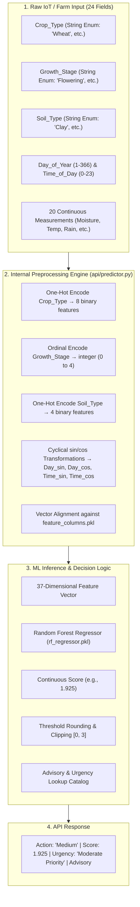

# Smart Irrigation Scheduling System

An end-to-end Machine Learning and IoT decision-support platform for precision agricultural irrigation scheduling. The platform consumes raw soil telemetry, environmental weather metrics, crop phenology, and temporal cycles to classify irrigation needs into four discrete management tiers: **No Irrigation**, **Low**, **Medium**, and **High**.

---

## Project Structure

```text
Soil problem/
├── data/
│   └── irrigation_scheduling.csv        ← Cleaned training dataset
├── models/
│   ├── rf_regressor.pkl                 ← Trained Random Forest Regressor
│   ├── scaler.pkl                       ← Fitted StandardScaler (for linear/neural models)
│   └── feature_columns.pkl              ← 37-dimensional ordered feature schema
├── notebook/
│   └── smart_irrigation_classifier.ipynb← EDA, model benchmarks, and training
├── api/
│   ├── main.py                          ← FastAPI application & endpoints
│   ├── schemas.py                       ← Pydantic v2 input/output validation models
│   ├── predictor.py                     ← 24→37 feature pipeline & inference engine
│   └── sample_input.json                ← Sample 24-feature test payload
├── tests/
│   └── test_main.py                     ← Pytest test suite (10 automated unit & API tests)
├── Dockerfile                           ← Multi-stage production container image
├── .dockerignore                        ← Docker build context exclusions
├── .gitignore                           ← Git repository ignore rules
├── requirements.txt                     ← Production & test dependencies
└── README.md                            ← Project documentation
```

---

## End-to-End Inference Pipeline: 24 Raw Fields $\to$ 37 Model Features

A key architectural strength of the API is that **clients submit clean, raw telemetry (24 fields)** without needing to replicate one-hot encodings or mathematical transformations on client devices. The API's inference engine ([api/predictor.py](file:///c:/Users/bello/Desktop/Soil%20problem/api/predictor.py)) handles full preprocessing internally:



### Preprocessing Transformation Matrix

| Raw Input (24 Fields) | Type | Preprocessing Applied | Resulting Features (37 Columns) |
| :--- | :--- | :--- | :--- |
| `Crop_Type` | String | One-Hot Encoding | `Crop_Type_Cotton`, `Crop_Type_Groundnut`, `Crop_Type_Maize`, `Crop_Type_Rice`, `Crop_Type_Soybean`, `Crop_Type_Sugarcane`, `Crop_Type_Tomato`, `Crop_Type_Wheat` (8 columns) |
| `Soil_Type` | String | One-Hot Encoding | `Soil_Type_Clay`, `Soil_Type_Loamy`, `Soil_Type_Sandy`, `Soil_Type_Silty` (4 columns) |
| `Growth_Stage` | String | Ordinal Mapping (`Seedling:0` $\to$ `Maturity:4`) | `Growth_Stage` (1 column) |
| `Day_of_Year` | Integer | $\sin(2\pi \cdot d / 365)$, $\cos(2\pi \cdot d / 365)$ | `Day_sin`, `Day_cos` (2 columns) |
| `Time_of_Day` | Integer | $\sin(2\pi \cdot t / 24)$, $\cos(2\pi \cdot t / 24)$ | `Time_sin`, `Time_cos` (2 columns) |
| 20 Sensor & Weather Metrics | Numeric | Direct pass-through | `Soil_Moisture`, `Soil_Temperature`, `Soil_pH`, `Soil_EC`, `Ambient_Temperature`, `Relative_Humidity`, `Wind_Speed`, `Solar_Radiation`, `Rainfall_24h`, `Rainfall_Forecast_24h`, `Root_Zone_Depth`, `Leaf_Area_Index`, `Crop_Coefficient`, `Field_Slope`, `Water_Availability`, `Previous_Irrigation_Amount`, `Days_Since_Last_Irrigation`, `Historical_Soil_Moisture`, `Evaporation_Demand`, `Water_Stress_Index` (20 columns) |
| **Total** | **24 inputs** | **Pipeline Transformations** | **37 model features** |

---

## REST API Endpoints Overview

| Method | Path | Request Body | Description |
| :--- | :--- | :--- | :--- |
| `GET` | `/` | None | API service metadata, online status, and route links |
| `GET` | `/health` | None | Service health status, model verification, feature count |
| `GET` | `/features` | None | Array of all 37 engineered feature column names |
| `POST` | `/predict` | `IrrigationInput` (24 fields) | Single field telemetry prediction |
| `POST` | `/predict/batch` | `IrrigationBatchInput` (list of items) | Batch predictions across multiple fields/sensors |
| `GET` | `/docs` | None | Interactive Swagger UI documentation |
| `GET` | `/redoc` | None | Interactive ReDoc documentation |

---

## Clarification on `scaler.pkl` vs Tree-Based Models

- **Random Forest (Active Model):** Decision tree splits are monotonic step functions evaluated independently per feature dimension. Consequently, tree algorithms are invariant to feature scaling (scaling or standardizing features does not change split points or predictions). In the production pipeline, the Random Forest model evaluates the 37 unscaled features directly, retaining physical unit interpretability.
- **Why `scaler.pkl` is preserved:** Fitted on `X_train` during exploratory modeling to benchmark distance/gradient-based architectures (e.g., `MLPRegressor`, Support Vector Machines, Ridge/Lasso). It is packaged in `models/` for pipeline compatibility if linear or neural backends are deployed.

---

## Model Benchmark & Evaluation Summary

| Model Architecture | Problem Type | Exact Accuracy | Adjacent Accuracy ($\pm 1$) | Mean Absolute Error (MAE) |
| :--- | :--- | :--- | :--- | :--- |
| **Random Forest Regressor (Deployed)** | **Ordinal** | **48.4%** | **94.3%** | **0.6236** |
| XGBoost Regressor | Ordinal | 48.2% | 94.3% | 0.6238 |
| MLP Regressor (Scaled) | Ordinal | 49.6% | 94.1% | 0.6252 |
| Random Forest Classifier | Nominal | 49.7% | N/A (unconstrained) | N/A |
| XGBoost Classifier | Nominal | 49.2% | N/A (unconstrained) | N/A |

> **Why Ordinal Modeling?** In agricultural scheduling, misclassifying a critical **High** irrigation need as **No_Irrigation** causes severe crop mortality, whereas predicting **Medium** is a benign adjacent error. The ordinal regressor penalizes distance quadratically, ensuring **>94% of predictions fall within $\pm 1$ class tier**.

---

## Installation & Quickstart

### 1. Local Environment Setup

```bash
# Clone the repository
git clone <repo-url>
cd "Soil problem"

# Create and activate a virtual environment
python -m venv env
# On Windows PowerShell:
.\env\Scripts\Activate.ps1
# On Linux / macOS:
source env/bin/activate

# Install dependencies
pip install -r requirements.txt
```

### 2. Run the FastAPI Development Server

```bash
uvicorn api.main:app --reload --host 0.0.0.0 --port 8000
```

- **Interactive API Swagger UI**: [http://127.0.0.1:8000/docs](http://127.0.0.1:8000/docs)
- **ReDoc Documentation**: [http://127.0.0.1:8000/redoc](http://127.0.0.1:8000/redoc)
- **Health Verification**: [http://127.0.0.1:8000/health](http://127.0.0.1:8000/health)

### 3. Run Automated Tests

The test suite validates root endpoints, health checks, 24-to-37 feature preprocessing logic, single/batch inference, and Pydantic validation error handling:

```bash
pytest tests/test_main.py -v
```

---

## Docker Deployment (Multi-Stage Build)

The application includes a production-grade multi-stage [Dockerfile](file:///c:/Users/bello/Desktop/Soil%20problem/Dockerfile) with a non-root user and automated container health checks.

```bash
# Build the Docker image
docker build -t smart-irrigation-api .

# Run the container
docker run -d -p 8000:8000 --name irrigation-service smart-irrigation-api

# Check container health status
docker ps
```

---

## API Usage Examples

### 1. Single Observation (`POST /predict`)

#### Using cURL and `sample_input.json`:
```bash
curl -X POST "http://127.0.0.1:8000/predict" \
  -H "Content-Type: application/json" \
  -d @api/sample_input.json
```

#### Raw cURL Command:
```bash
curl -X POST "http://127.0.0.1:8000/predict" \
  -H "Content-Type: application/json" \
  -d '{
    "Crop_Type": "Wheat",
    "Growth_Stage": "Flowering",
    "Soil_Type": "Clay",
    "Day_of_Year": 306,
    "Time_of_Day": 16,
    "Soil_Moisture": 34.65,
    "Soil_Temperature": 28.48,
    "Soil_pH": 7.22,
    "Soil_EC": 1.63,
    "Ambient_Temperature": 25.16,
    "Relative_Humidity": 75.88,
    "Wind_Speed": 2.06,
    "Solar_Radiation": 617.89,
    "Rainfall_24h": 1.66,
    "Rainfall_Forecast_24h": 11.78,
    "Root_Zone_Depth": 35.23,
    "Leaf_Area_Index": 4.19,
    "Crop_Coefficient": 1.15,
    "Field_Slope": 4.86,
    "Water_Availability": 65.38,
    "Previous_Irrigation_Amount": 10.5,
    "Days_Since_Last_Irrigation": 7,
    "Historical_Soil_Moisture": 24.66,
    "Evaporation_Demand": 52.41,
    "Water_Stress_Index": 76.23
  }'
```

#### JSON Response:
```json
{
  "predicted_action": "Medium",
  "predicted_class_index": 2,
  "raw_continuous_score": 1.925,
  "urgency_level": "Moderate Priority",
  "advisory": "Moderate water stress observed across field telemetry. Apply scheduled regular irrigation to maintain target root-zone moisture."
}
```

### 2. Batch Observation (`POST /predict/batch`)

#### cURL Command:
```bash
curl -X POST "http://127.0.0.1:8000/predict/batch" \
  -H "Content-Type: application/json" \
  -d '{
    "items": [
      {
        "Crop_Type": "Wheat",
        "Growth_Stage": "Flowering",
        "Soil_Type": "Clay",
        "Day_of_Year": 306,
        "Time_of_Day": 16,
        "Soil_Moisture": 34.65,
        "Soil_Temperature": 28.48,
        "Soil_pH": 7.22,
        "Soil_EC": 1.63,
        "Ambient_Temperature": 25.16,
        "Relative_Humidity": 75.88,
        "Wind_Speed": 2.06,
        "Solar_Radiation": 617.89,
        "Rainfall_24h": 1.66,
        "Rainfall_Forecast_24h": 11.78,
        "Root_Zone_Depth": 35.23,
        "Leaf_Area_Index": 4.19,
        "Crop_Coefficient": 1.15,
        "Field_Slope": 4.86,
        "Water_Availability": 65.38,
        "Previous_Irrigation_Amount": 10.5,
        "Days_Since_Last_Irrigation": 7,
        "Historical_Soil_Moisture": 24.66,
        "Evaporation_Demand": 52.41,
        "Water_Stress_Index": 76.23
      }
    ]
  }'
```

#### JSON Response:
```json
{
  "total_count": 1,
  "predictions": [
    {
      "predicted_action": "Medium",
      "predicted_class_index": 2,
      "raw_continuous_score": 1.925,
      "urgency_level": "Moderate Priority",
      "advisory": "Moderate water stress observed across field telemetry. Apply scheduled regular irrigation to maintain target root-zone moisture."
    }
  ]
}
```

### 3. Python Client Example

```python
import json
import requests

with open("api/sample_input.json", "r") as f:
    payload = json.load(f)

# Single prediction
response = requests.post("http://127.0.0.1:8000/predict", json=payload)
print("Single Prediction:", response.json())

# Batch prediction
batch_payload = {"items": [payload]}
batch_response = requests.post("http://127.0.0.1:8000/predict/batch", json=batch_payload)
print("Batch Prediction:", batch_response.json())
```
